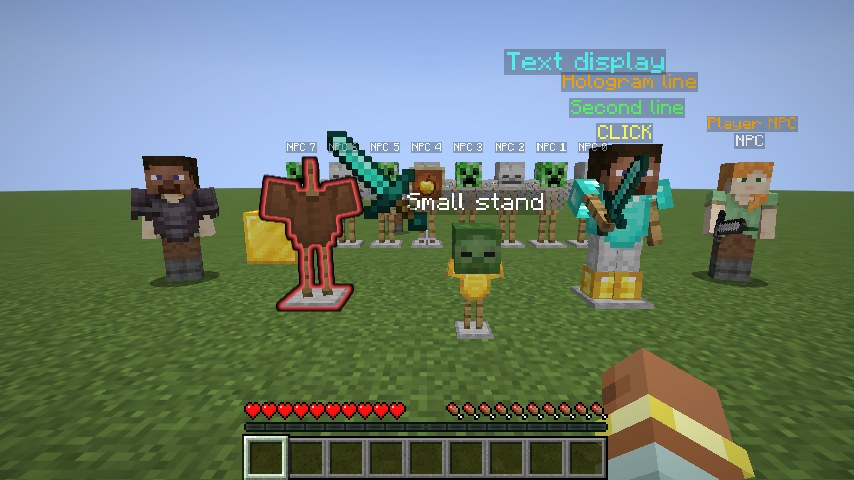
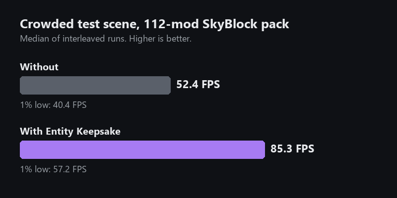
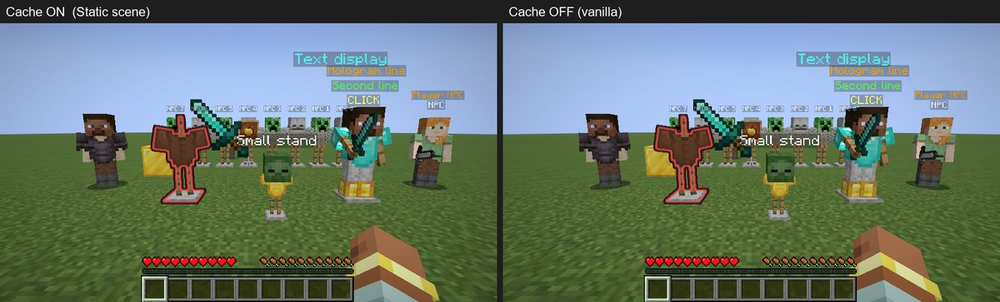

# Entity Keepsake: FPS Boost for Armor Stands, Holograms and NPCs

> More FPS around armor stands, holograms, NPCs, item frames and display entities. Built for **Hypixel SkyBlock**. Nothing is hidden or culled: everything is still drawn every frame. Client-side Fabric mod for Minecraft Java **26.2**.

Entity Keepsake is a **100% client-side Fabric performance mod** that fixes entity lag:

- Minecraft rebuilds **every visible entity every frame**, even ones that haven't moved in an hour.
- Servers like Hypixel build every hologram and NPC name from stacks of invisible armor stands, so one hub can have hundreds.
- Entity Keepsake **keeps the work for entities that haven't changed** and reuses it on the next frame.

Nothing to install on the server, so it works on Hypixel and any other server.

## Up to 63% more FPS in crowded areas

Tested in a 112-mod Hypixel SkyBlock modpack, in a crowded scene full of hologram stands and player NPCs (median of interleaved runs):

| | Average FPS | 1% low FPS |
|---|---|---|
| Without Entity Keepsake | 52.4 | 40.4 |
| **With Entity Keepsake** | **85.3** | **57.2** |

Your gain depends on your PC and on how many still entities are on screen: it's biggest in busy hubs and small in an empty world.

## What it speeds up
- **Armor stands:** invisible, marker, small and named armor stands.
- **Holograms and floating text:** hologram stacks, NPC name tags and floating labels.
- **NPCs:** player-shaped NPCs, mannequins and players standing still. Your own player is never touched.
- **Item frames** with items in them (maps are left alone).
- **Display entities:** block, item and text displays, including ones that turn to face you.

## How it works
1. **Render state caching:** the description of how an entity should look is reused instead of rebuilt.
2. **Name tag layout caching:** the text layout of name tags and holograms is kept.
3. **Vertex replay:** the finished geometry of still armor stands, heads and items is reused, shifted for camera movement.
4. **Draw replay:** a still armor stand's list of draws is recorded and replayed instead of running its renderer again.

Nothing is reused on trust: geometry is only replayed after two normal builds in a row came out exactly the same.

## Looks exactly like vanilla
- **Anything that moves is rebuilt.** Position, rotation, head turns, animations and display updates are checked every frame.
- **Moving, hurt, burning or swinging entities are always drawn normally**, and so is the entity under your crosshair.
- **Glowing entities and highlights work**, so SkyHanni and Skyblocker highlights still show.
- **Safety net:** every cached entity is rebuilt from scratch at least once a second.

## Works with Sodium and SkyBlock mods
Tested with **Sodium, Lithium, ImmediatelyFast, Entity Culling, More Culling, SkyHanni, Skyblocker, Odin, Entity Model Features, Entity Texture Features, 3D Skin Layers and Not Enough Animations**. The FPS numbers above were measured with those mods installed. A built-in self-check compared every reused result with a freshly built one: **8,669,909 checks, 0 differences**.

## Installation
1. Install [Fabric Loader](https://fabricmc.net/use/) and [Fabric API](https://modrinth.com/mod/fabric-api) for Minecraft 26.2.
2. Download Entity Keepsake from [Modrinth](https://modrinth.com/mod/entity-keepsake) or [CurseForge](https://www.curseforge.com/minecraft/mc-mods/entity-keepsake).
3. Drop the `.jar` into your `mods` folder and launch. Nothing to set up.

If you use Fast Static Entity, remove it first: they cache the same things.

## Commands and config
- `/entitykeepsake`: shows how many entities were reused or rebuilt.
- `/entitykeepsake on` / `/entitykeepsake off`: turn the mod on or off in game, handy for comparing FPS.
- `/entitykeepsake reset`: resets the counters.
- `/entitykeepsake verify`: compares every reused result with a freshly built one and lists any difference. It's slow, so turn it off when you're done.

In `config/entitykeepsake.properties`, `enabled=false` turns everything off. Single parts can be turned off with `name_tag_layouts=false`, `vertex_replay=false`, `name_tag_replay=false` and `submit_replay=false`. `update_notice=false` stops the chat message when a new version is out.

## Guides
- [How to fix entity lag in Minecraft](https://merenotnoonereal.github.io/entity-keepsake/how-to-fix-entity-lag/)
- [Fix low FPS in the Hypixel SkyBlock hub](https://merenotnoonereal.github.io/entity-keepsake/hypixel-skyblock-hub-fps/)
- [Why armor stands and holograms cause lag](https://merenotnoonereal.github.io/entity-keepsake/armor-stand-hologram-lag/)
- [Fast Static Entity alternative](https://merenotnoonereal.github.io/entity-keepsake/fast-static-entity-alternative/)

## FAQ
- **Does it hide or cull entities?** No. Every entity is still drawn every frame. It only skips redoing work for entities that haven't changed.
- **Does it work on Hypixel SkyBlock?** Yes, it was built for it and tested there. It gives no gameplay advantage, but check your server's rules.
- **Does it work with Sodium and Entity Culling?** Yes. Culling mods skip entities you can't see; Entity Keepsake speeds up the ones you can, so they stack.
- **Needed on the server?** No. It's fully client-side.
- **Is it a Fast Static Entity alternative?** Yes. It's a clean-room remake, written only from a description of how the original behaves, that also covers holograms, player NPCs, billboarded displays and glowing entities.
- **Something looks wrong?** Run `/entitykeepsake verify` and `/entitykeepsake off` to check, and please [open an issue](https://github.com/merenotnoonereal/entity-keepsake/issues).

## Compatibility
| | |
|---|---|
| Loader | Fabric |
| Minecraft | 26.2 |
| Dependencies | Fabric API |
| Environment | Client only |

## Links
- **Modrinth:** https://modrinth.com/mod/entity-keepsake
- **CurseForge:** https://www.curseforge.com/minecraft/mc-mods/entity-keepsake
- **Website:** https://merenotnoonereal.github.io/entity-keepsake/ (22 languages)
- **Also by me:** [NoForcedPacks](https://merenotnoonereal.github.io/noforcedpacks/), [Hand Animations](https://merenotnoonereal.github.io/handanimations/)

## License
**All rights reserved.** See the `LICENSE` file. This mod is not open source. Please don't re-upload or redistribute it; link to the official Modrinth/CurseForge pages instead.
